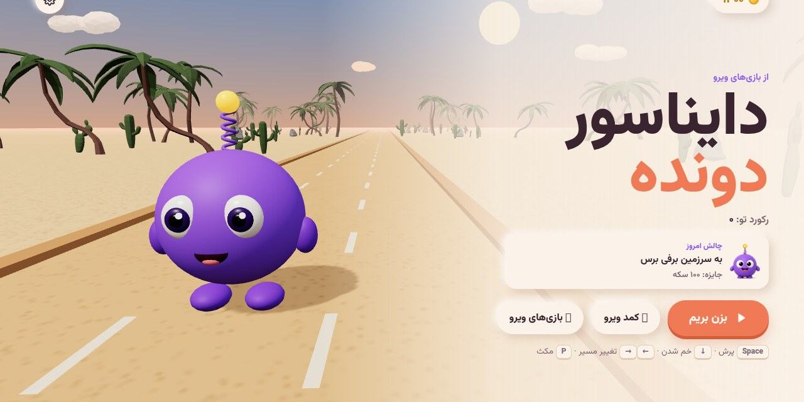
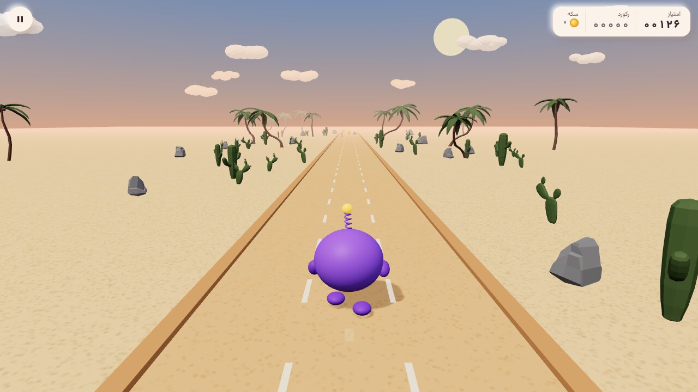
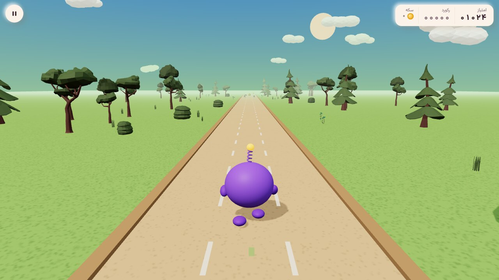
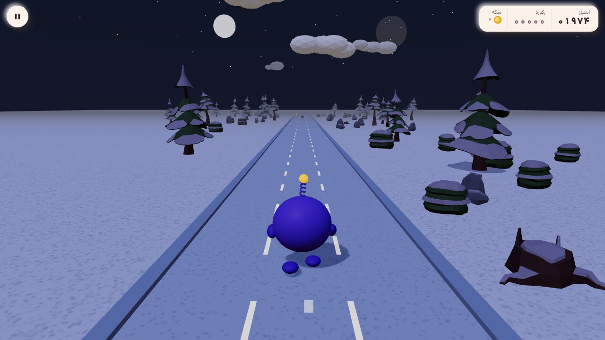
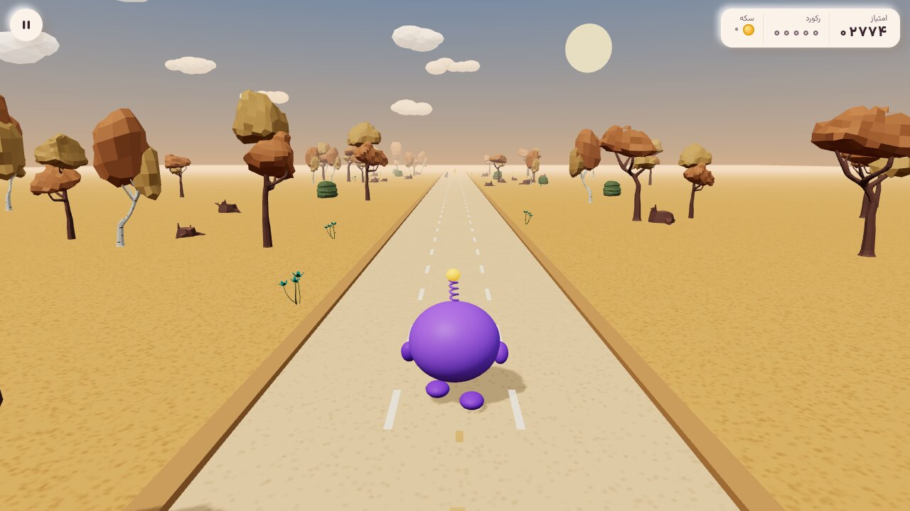
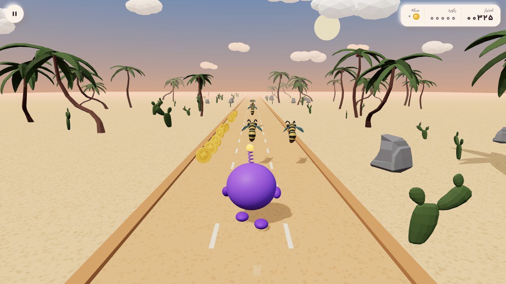
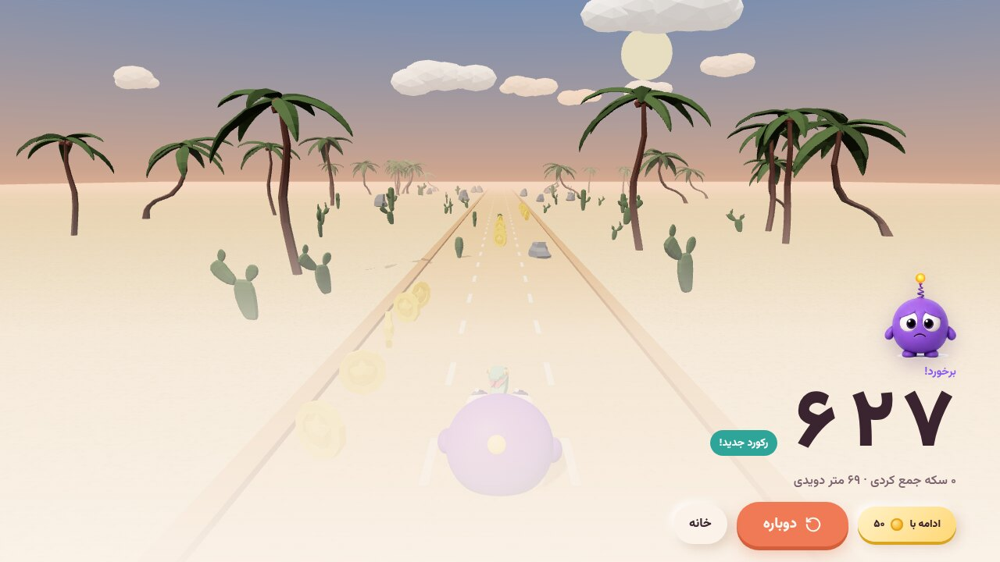
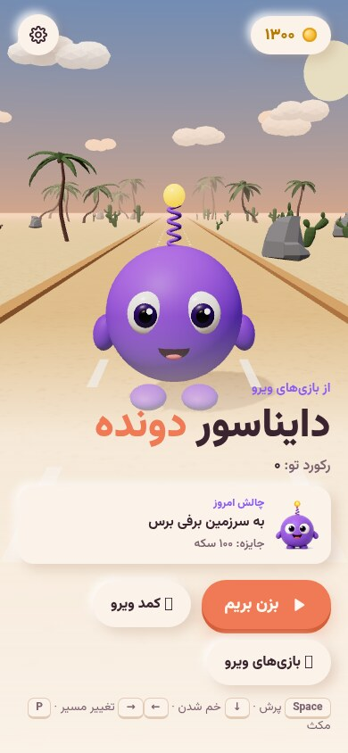
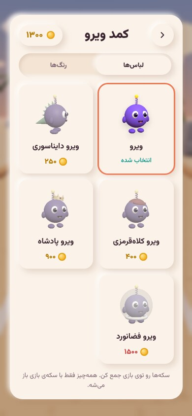
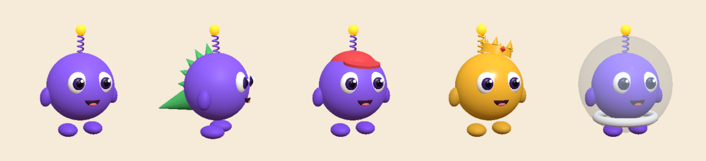

<div align="center">


# دایناسور دونده | Viro Dino Runner

**یک بازی دوندگی سه‌بعدی، رنگی و آفلاین با ویرو، شخصیت بنفش و بامزه‌ی Viro Games**




</div>

<div dir="rtl">

## درباره‌ی بازی

ویرو، موجود بنفش کوچولو با آنتن فنری و چراغ زردش، راه افتاده تا از بیابان داغ تا جنگل سبز، دشت برفی و پاییز طلایی بدود. سر راهش سنگ و کنده و کاکتوس هست، مارها کمین کرده‌اند و زنبورها از بالا حمله می‌کنند. بپر، خم شو، مسیر عوض کن و تا می‌تونی سکه جمع کن.

بازی کاملاً آفلاین است، تبلیغ ندارد، ثبت‌نام نمی‌خواهد و برای همه‌ی سنین مناسب است.

## ویژگی‌ها

- 🟣 **ویروی سه‌بعدی** با انیمیشن دویدن، پریدن، پلک‌زدن و آنتنی که تکان می‌خورد
- 🌍 **چهار سرزمین**: بیابان، جنگل، برفی و پاییز که در طول بازی عوض می‌شوند
- 🌙 **شب و روز** با آسمان، ابر، مه، نور و سایه‌ی نرم
- 🐝 **موانع متنوع**: سنگ، کنده، کاکتوس، مار و زنبور پرنده
- 🧲 **قدرت‌ها**: آهن‌ربای سکه و سپر محافظ
- 👕 **کمد ویرو**: ۵ لباس (دایناسوری، کلاه‌قرمزی، پادشاه، فضانورد) و ۶ رنگ که با سکه باز می‌شوند
- 🎯 **چالش روزانه** با جایزه‌ی سکه
- ❤️ **ادامه‌ی بازی** بعد از برخورد با سکه
- ⚙️ تنظیم صدا، لرزش و کیفیت گرافیک برای گوشی‌های ضعیف‌تر
- 🔤 رابط کاملاً فارسی و راست‌به‌چپ با فونت وزیرمتن

## تصاویر

<table>
<tr>
<td></td>
<td></td>
</tr>
<tr>
<td align="center">بیابان</td>
<td align="center">جنگل</td>
</tr>
<tr>
<td></td>
<td></td>
</tr>
<tr>
<td align="center">شب برفی</td>
<td align="center">پاییز</td>
</tr>
<tr>
<td></td>
<td></td>
</tr>
<tr>
<td align="center">حمله‌ی زنبورها، وقت خم شدن!</td>
<td align="center">پایان بازی و رکورد جدید</td>
</tr>
</table>

<p align="center">

&nbsp;&nbsp;

</p>

<p align="center"></p>
<p align="center">ویرو، ویرو دایناسوری، ویرو کلاه‌قرمزی، ویرو پادشاه، ویرو فضانورد</p>

## کنترل‌ها

| کار | کیبورد | لمسی |
|---|---|---|
| تغییر مسیر | ← → یا A D | کشیدن به چپ و راست |
| پرش | ↑ یا W یا Space | کشیدن به بالا یا ضربه |
| خم شدن | ↓ یا S | کشیدن به پایین |
| توقف | P یا Esc | دکمه‌ی توقف |

## دانلود

- **ویندوز:** نسخه‌ی نصبی (`setup.exe`) یا قابل‌حمل (`portable.exe`) از بخش [Releases](../../releases)
- **اندروید:** به‌زودی در کافه‌بازار و مایکت

> اگر ویندوز هشدار SmartScreen داد، روی More info و بعد Run anyway بزنید.

## ساخت از سورس

```bash
npm install
npm run dev            # اجرا در مرورگر
npx vite build         # ساخت نسخه‌ی وب در dist/
npx tauri build        # بسته‌ی دسکتاپ با Tauri 2
```

## فناوری‌ها

Vite · JavaScript · three.js · Tauri 2 · WebAudio · localStorage

## اعتبار منابع

- مدل‌های سه‌بعدی محیط و موانع: [Quaternius](https://quaternius.com) (CC0)
- فونت: [Vazirmatn](https://github.com/rastikerdar/vazirmatn) (OFL)
- موتور سه‌بعدی: [three.js](https://threejs.org) (MIT)

جزئیات در [CREDITS.md](CREDITS.md).

---

<p align="center">ساخته‌شده با 💜 توسط <b>Viro Games</b></p>

</div>

---

## English

**Viro Dino Runner** is a colorful, fully offline 3D endless runner starring Viro, the purple mascot of Viro Games. Run through desert, forest, snowy and autumn lands with a day/night cycle, dodge rocks, cactuses, snakes and flying wasps, grab coins, magnets and shields, and unlock 5 outfits and 6 colors in Viro's Closet. No ads, no sign-up, Persian RTL interface.

Built with Vite, vanilla JavaScript, three.js and Tauri 2. 3D scenery by Quaternius (CC0).
